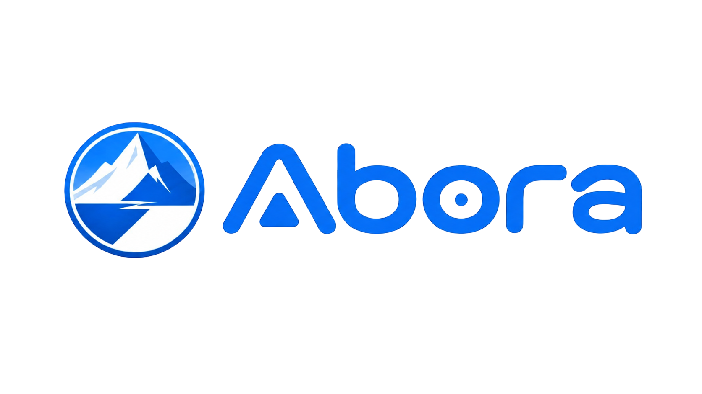
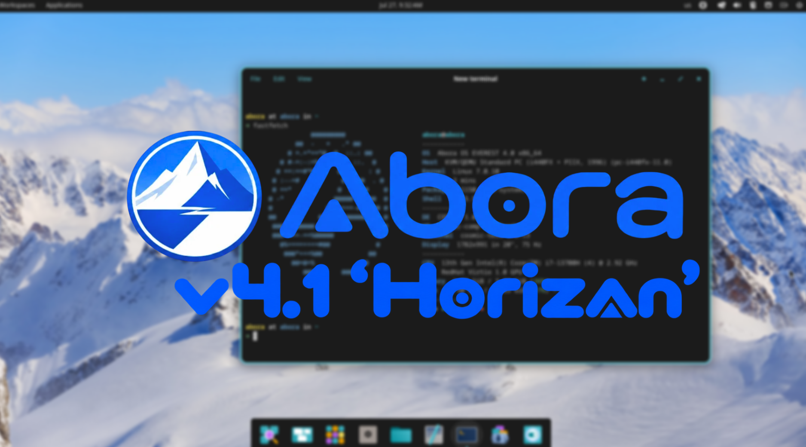
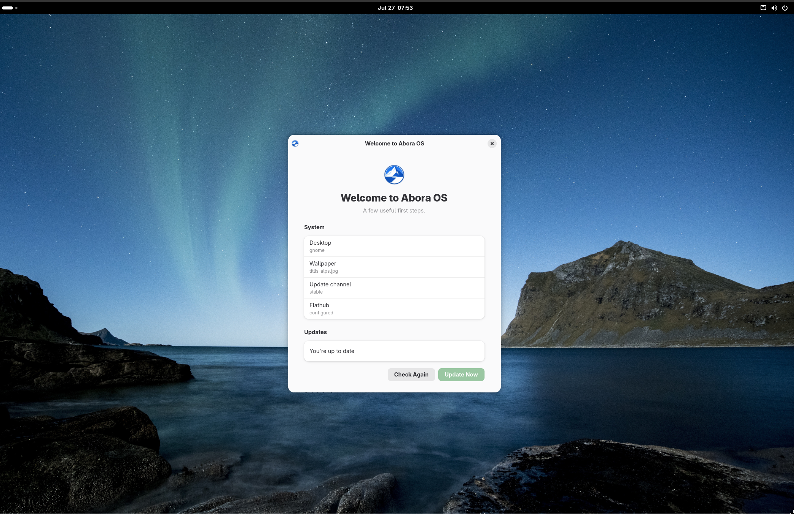
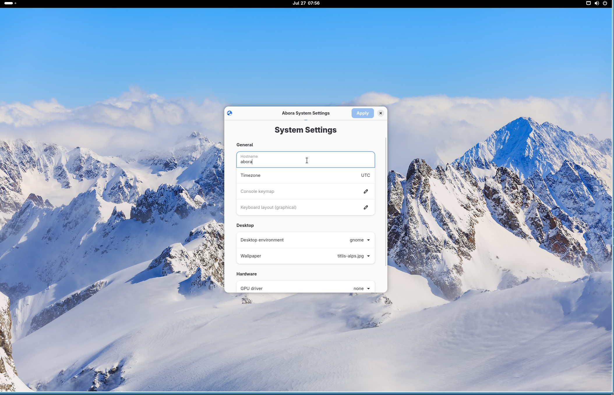
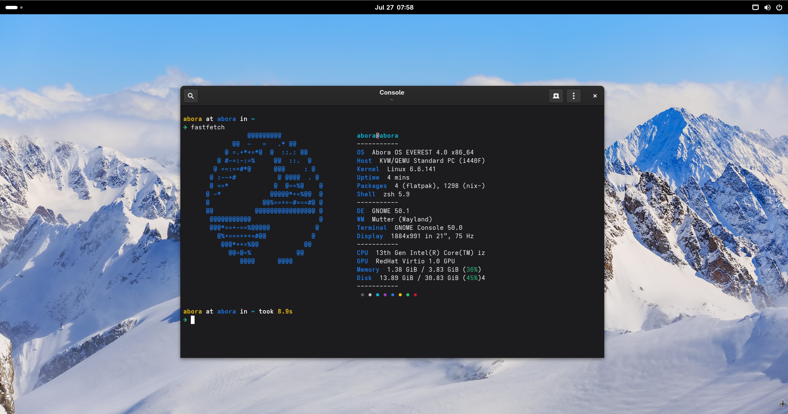
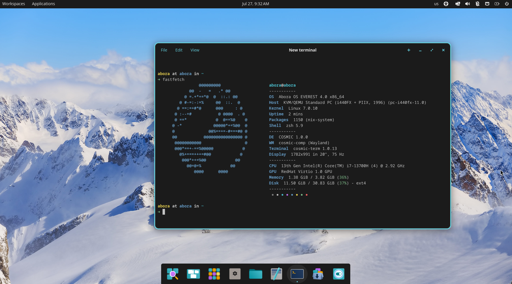

<p align="center">
  
</p>

<p align="center"><strong>A NixOS-based Linux distribution built to be easier to install, use, and understand.</strong></p>

<p align="center">
  <a href="https://aboraos.org"></a>
  <a href="https://github.com/AnimatedGTVR/Abora-OS/releases"></a>
  <a href="docs/wiki/Home.md"></a>
</p>

<p align="center">
  
</p>

Abora OS was created by **AnimatedGTVR** and is developed with help from community contributors.

## About Abora

Abora keeps NixOS's declarative configuration, reproducible builds, atomic upgrades, and rollbacks while providing a guided installer, practical defaults, several desktop editions, and simpler management tools.

Current editions include COSMIC, GNOME, KDE Plasma, Hyprland, and Other Desktops. Abora is still a young project: test important releases before installing them on your main machine.

## Screenshots

<table>
  <tr>
    <td></td>
    <td></td>
  </tr>
  <tr>
    <td></td>
    <td></td>
  </tr>
</table>

## Main features

- Guided installation and hardware-aware defaults
- Stable and Edge release channels
- `abora` tools for updates, recovery, gaming, diagnostics, and setup
- ANIX for profiles, generations, snapshots, and rollback
- Optional TinyPM application layer and Abora Labs experiments
- Multiple desktop environments from one shared base

## Download and install

Download an ISO from [aboraos.org](https://aboraos.org) or [GitHub Releases](https://github.com/AnimatedGTVR/Abora-OS/releases). Read the [installation guide](docs/wiki/Installation.md) before writing it to a USB drive.

Stable is intended for normal use. Edge receives unfinished changes first and may break:

```sh
sudo abora channel set stable
sudo abora channel set unstable
```

## Common commands

```sh
sudo abora update
abora doctor
abora recovery
abora setup
anix status
tinypm providers
```

See [Abora Tools](docs/wiki/Abora-Tools.md), [Updating](docs/wiki/Updating-Abora.md), and [Recovery](docs/wiki/Recovery.md) for more.

## Build from source

```sh
git clone https://github.com/AnimatedGTVR/Abora-OS.git
cd Abora-OS
make doctor
make check
make iso
```

Use `make qemu-fresh` for a clean VM install test and `make release` only when preparing the complete release bundle.

## Contributing

Bug reports, hardware tests, documentation fixes, artwork, and focused code changes are welcome. Read [CONTRIBUTING.md](CONTRIBUTING.md), and report security problems through [SECURITY.md](SECURITY.md).

## Project links

- [Documentation](docs/wiki/Home.md)
- [Release notes](RELEASE_NOTES.md)
- [Roadmap](docs/roadmap.md)
- [Code of Conduct](CODE_OF_CONDUCT.md)
- [License](LICENSE)
